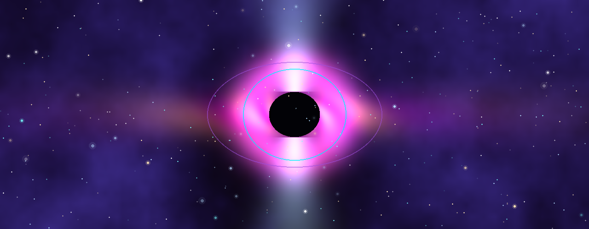
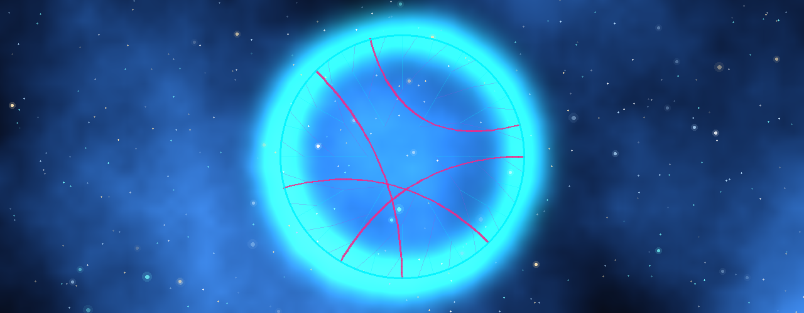
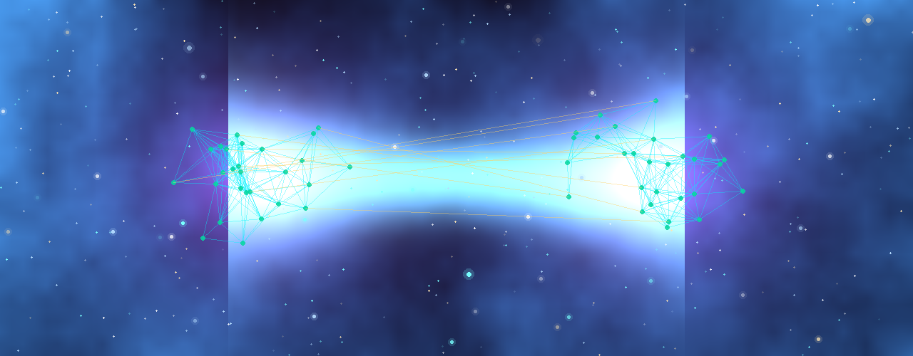
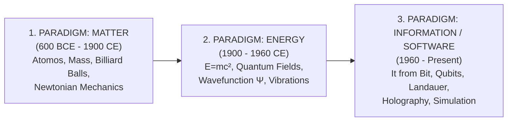

# 🌌 The Building Block of the Universe: From Matter to Bit

[](index.html)
[](cli/test_universe.py)
[](docs/)
[](LICENSE)

> *"The cosmos is within us. We are made of star-stuff. We are a way for the cosmos to know itself."*  
> — **Carl Sagan**

> *"It from bit. All things physical are information-theoretic in origin and this is a participatory universe."*  
> — **John Archibald Wheeler**

---

## 📖 About the Project

**"What is the universe made of?"** is the primary ontological and physical question humanity has pursued for over 2,600 years.

This platform documents the evolution of our understanding of reality across three grand paradigms: from **"Matter"** (Atom/Substance) to **"Energy and Fields"** (Quantum Field Theory, $E=mc^2$), and finally to **"Information and Computation"** (Digital Physics, *It from Bit*, *It from Qubit*, Holographic Principle, Simulation Hypothesis). It features **10 real-time interactive simulation labs**, **28 chronological historical milestones**, a **24-term Cosmic Conceptual Glossary**, a **15-question Quiz**, **6 Interactive Theory Chapters**, mathematical equations, and a **10-module Python computational CLI tool**.

---

## 🎨 Visual Gallery & Thematic Banners (8 HD Visuals)

The 8 high-resolution (`1280 × 500`) thematic banners embedded across the portal:

| 🌌 1. Grand Evolution from Matter to Bit | 🏛️ 2. Ancient Natural Philosophy & Arche |
| :---: | :---: |
|  |  |

| ⚛️ 3. Quantum Field Theory & Wave Mechanics | 💾 4. It from Bit & Holographic Black Hole |
| :---: | :---: |
|  |  |

| 🌐 5. Simulated Multiverse & Quantum Computing | 🌀 6. Kerr Rotating Black Hole & Ergosphere |
| :---: | :---: |
|  |  |

| 🕸️ 7. AdS/CFT Poincaré Disk & Ryu-Takayanagi Web | 🧬 8. Wolfram Ruliad Hypergraph & ER=EPR Bridge |
| :---: | :---: |
|  |  |

---

## 🏛️ The Three Ontological Revolutions



---

## 🔬 10 Interactive Simulation Laboratories

The portal features 10 real-time simulators:

1. **Atomic Models & Orbitals:** Democritus solid sphere, Bohr quantized orbits, and Schrödinger probability cloud with photon excitation trigger.
2. **Quantum Double Slit & Collapse:** Photon wave interference patterns and observer-induced wavefunction collapse into particle paths.
3. **Konrad Zuse & Stephen Wolfram Cellular Automata:** Rule 30 (deterministic chaos), Rule 110 (Turing complete), Rule 90 (Sierpinski fractal), and Rule 184 (traffic/flow dynamics).
4. **Qubit & Bloch Sphere Universal Gates:** 3D state vector $|\Psi\rangle = \cos(\theta/2)|0\rangle + e^{i\phi}\sin(\theta/2)|1\rangle$, Hadamard ($H$), Pauli ($X, Y, Z$), Phase ($S, T$) gates, Bloch coordinates $(x, y, z)$, and probability bars.
5. **Black Hole, Kerr Ergosphere & Holography Calculator:** Presets (Solar mass, Cygnus X-1, Sgr A*, M87*, TON 618), Kerr spin parameter ($a/M$), outer/inner horizons, ergosphere, Penrose process rotational energy efficiency ($\le 29.3\%$), Bekenstein-Hawking entropy, and real-time canvas visualization.
6. **Nick Bostrom Simulation Trilemma:** Bayesian simulation probability calculation $P(\text{Sim}) = \frac{f_p N_I}{f_p N_I + 1}$ with interactive civilizational parameters.
7. **Quantum Entanglement & Bell Inequality (EPR):** Alice and Bob polarizer angle controls ($\theta_A, \theta_B$), quantum correlation $E(\theta_A, \theta_B) = -\cos(2(\theta_A - \theta_B))$, and CHSH inequality violation test ($S = 2\sqrt{2} \approx 2.828 > 2$).
8. **Cosmic Scales & Seth Lloyd Information Hierarchy:** Interactive explorer from Planck scale ($10^{-35}$ m) to the Observable Universe ($10^{26}$ m) with masses and information capacities in bits.
9. **Landauer Bit Erasure & Maxwell's Demon Simulator:** Bitstream Shannon entropy $H(X)$, ambient temperature ($2.7\text{ K} - 1000\text{ K}$), single-bit Landauer limit ($k_B T \ln 2$), dissipated heat ($\Delta Q$), and interactive Maxwell's Demon particle chamber animation.
10. **AdS/CFT Holography & Ryu-Takayanagi Entanglement Network ("It from Qubit"):** Poincaré disk hyperbolic AdS bulk tensor network, boundary CFT subsystem angle ($\theta_A$), central charge ($c$), minimal geodesic curve ($\gamma_A$), and Ryu-Takayanagi entanglement entropy $S_A = \frac{\text{Area}(\gamma_A)}{4G_N}$.

---

## 📊 The Grand Comparison Matrix (Matter vs Energy vs Information)

| Dimension / Feature | 1. Matter Paradigm | 2. Energy & Field Paradigm | 3. Information Paradigm (It from Bit) |
| :--- | :--- | :--- | :--- |
| **Fundamental Ontology** | Indivisible solid particles | Continuous oscillating fields & quanta | Discrete bits/qubits, algorithms |
| **Fundamental Unit** | Mass (kg / Dalton) | Joule / Quantum ($E = h\nu$) | Bit (0/1) / Qubit ($|\Psi\rangle$) |
| **Conservation Law** | Mass Conservation (Lavoisier) | Energy Conservation ($E=mc^2$) | Information Conservation (Unitarity) |
| **Spacetime** | Fixed, absolute 3D arena (Newton) | Dynamic curved 4D manifold (Einstein) | Emergent hologram from entanglement networks |
| **Governing Equation** | $F = ma$, $F = G \frac{m_1 m_2}{r^2}$ | $E = mc^2$, $\Delta x \Delta p \ge \hbar/2$ | $S = \frac{k_B A}{4\ell_P^2}$, $E_{\text{min}} \ge k_B T \ln 2$ |
| **Speed / Op Limit** | Finite mechanical velocity | Speed of Light ($c = 299,792,458\text{ m/s}$) | Margolus-Levitin ($R_{\text{max}} = \frac{2E}{\pi\hbar}$) |
| **Observer's Role** | Passive external spectator | Frame-dependent (Lorentz dilation) | Active participant (Wavefunction collapse) |

---

## 💻 Python CLI Tool

Run theoretical astrophysics and quantum information calculations in your terminal:

```bash
# Interactive CLI
python cli/universe_info.py

# Run unit tests
python cli/test_universe.py

# JSON output
python cli/universe_info.py --json
```

---

## 🚀 Getting Started

Simply open `index.html` in any modern web browser or serve it locally:
```bash
python -m http.server 3000
```
Navigate to `http://localhost:3000`.

---

## 📜 License

This project is licensed under the [MIT License](LICENSE).
